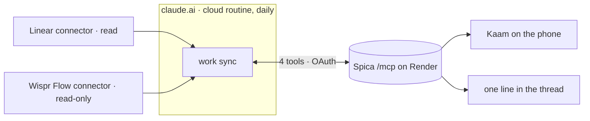

# Work sync — Linear and Wispr Flow into Kaam, by a Claude routine

> Status: **built and verified locally 2026-09-27** — steps 1–3 and 6 of the
> build order, tested (`backend/tests/test_work_sync.py`) and run end to end
> against the live dev server with the real Linear and Wispr Flow connectors
> (§ Running it before deployment). Steps 4 and 5 — Render, and the cloud
> routine on claude.ai — remain.
> Surface: backend (an MCP server at `/mcp`, OAuth, two migrations) · a cloud
> routine configured in claude.ai · Kaam (provenance, the reminder, and the
> page where a connector is approved)
> Depends on: the Render deployment (its own spec, not yet written) · the repo
> on a private GitHub remote · Linear and Wispr Flow connected on the claude.ai
> account that owns the routine
> Replaces: `task-sync.md`, archived as `spec/archive/repo-task-scanner.md`
> First slice of: `spec/agent-everywhere.md`, which stays future scope

## The problem

Work tasks arrive in two places the user already uses and Spica cannot see:
**Linear**, where issues are assigned, and **Wispr Flow**, where meetings are
recorded and their action items land. Kaam has the tables for tasks
(`spec/done/work-data-model.md`) and nothing that fills them — every task in it
today was imported or typed by hand. Knowing what the day holds still means
opening Linear and re-reading yesterday's standup, which is the scatter this
app exists to end.

## The shape

Once a day a **Claude cloud routine** asks Spica what it already knows, reads
Linear and Wispr Flow through the connectors the user already has, and writes
the difference into Spica through Spica's own **MCP server**. Spica never
talks to Linear or Wispr and holds no credentials for either; the routine is
the only thing that touches both sides, and in v1 it only reads them. A Linear
task ticked done in Spica is a reminder to move it in Linear — Spica never
moves it.



| Piece | Lives in | Job |
|---|---|---|
| The routine | claude.ai, **Cloud** | Fires on a schedule set in Claude's Routines page. Its prompt is one line |
| Linear connector | claude.ai | Read the user's issues and their teams' stages. Nothing is written in v1 |
| Wispr Flow connector | claude.ai | Read meetings and their action items. It cannot write |
| Spica connector | claude.ai custom connector → `https://<render host>/mcp` | Four tools, authenticated by OAuth |
| The instructions | `backend/app/agent/skills/work-sync/`, returned by `work_sync_begin` | How to read each source and what to write |

### Why a cloud routine

It runs with the Mac off. A local desktop task fires only while the Claude app
is open and the Mac awake; the user's existing local task showed both failure
modes in one week — a day with no run at all, and a catch-up run two hours
late when the Mac woke. Cloud routines use the account's claude.ai connectors
and can run as often as hourly.

### Why the schedule lives in Claude, not in Spica

The clock that fires the run is Claude's. A copy of the time in Spica's
`schedules` table could be changed without changing when anything runs, and
the Profile screen would then state a time that is not true. So the time is set
in one place — the routine in Claude's Routines page — and Spica records what
each run did (§ `work_sync_finish`). `schedules` stays what
`spec/in-progress/borrowed-runners.md` made it: the runner for jobs that must
run without Claude at all, like the nightly categoriser.

### Why Spica serves the instructions

The routine's prompt is one line: *"Call `work_sync_begin` on the Spica
connector and follow the instructions it returns."* The instructions arrive in
the same call as the live context, for two reasons. They describe how Spica's
tools behave, so shipping them with the server is what stops the two drifting
apart. And the live half — open tasks, what is waiting to be moved — has to come from Spica
anyway. Improving the routine is a deploy, never an edit in a text box on
claude.ai.

It is the same two-half pattern as `skills/categorise.md` and
`skills/estimate.md`: a static half in the repo, a generated half built from
rows at call time and never stored.

## Two shapes of source

Sources are sorted by **shape**, not by name. Every future source picks one,
and the server logic does not change.

| | **Tracker item** | **Document** |
|---|---|---|
| v1 source | Linear issue | Wispr Flow meeting |
| Later, for example | Jira, GitHub issues | Gmail, a Slack thread |
| Changes after it is first seen | Yes — due date, state, assignee | Never — a transcript is final |
| One item is | exactly one task | zero or more tasks |
| Identity | the source's own id → `tasks.source_key` | the document's id → `source_documents.ref` |
| Read | every run, matched by key | once, then never again |
| Dedup | deterministic — no model involved | the model compares new items with open tasks |

### Trackers — re-read every run, matched by key

A Linear issue keeps changing after Spica first sees it, so reading it once
would miss a moved due date or a teammate closing it. It is read every run and
matched on `(source, source_key)`. The key is Linear's issue **UUID**, not
`ENG-142`: the identifier changes when an issue moves team, and the UUID does
not. `ENG-142` is kept as `source_ref`, the human pointer.

The tasks table is its own record of what was processed. The key is stored on
the row — **including on soft-deleted rows** — so a task deleted in Spica is
recognised on the next run and never recreated.

### Documents — processed once

A meeting never changes once recorded, so it is read once and its id stored in
`source_documents`. A task row is not enough of a record: a meeting that
produced nothing for this person leaves no row, and would be re-read every run
forever.

The record is a list of ids, not a *since last run* timestamp. Wispr can finish
a transcript hours after the meeting ends, and a run can fail halfway; a
timestamp skips both, a list of processed ids catches both.

### What the model still judges

One fuzzy step survives: the action items from **new** meetings, compared
against **open** tasks, deciding for each whether it is new or the same as a
task that already exists — *"send Amit the deck"* against an open *"Deck to
Amit by Friday"*. Nothing done or deleted can reach that comparison, because
old documents are never re-read and trackers match by key. That is why
comparing against open tasks alone is enough.

- **The model never creates an id.** It answers `same_as` with an id from the
  list Spica gave it; the server checks that id belongs to this user. Every
  new id is assigned by the server.
- **When unsure, create.** A duplicate costs one delete; a wrong merge loses a
  real task silently. The run report names any item created despite
  resembling an open task, so the user can check it.

## A run, step by step

1. **`work_sync_begin`** — instructions, open tasks, what is waiting to be
   moved in Linear, projects.
2. **Pull Linear.** Issues assigned to the user in an unstarted or started
   state, plus any issue assigned to the user and updated in the last 14 days —
   which catches completions, cancellations and reassignments. Each becomes a
   `tasks_upsert` item carrying `source_key` and the issue's current stage.
3. **Read Wispr.** Meetings from the last 14 days go to `sources_unseen`. For
   each unseen meeting, the action items that belong to the user are compared
   against open tasks and sent to `tasks_upsert` as new or `same_as`. Items
   owned by someone else in the meeting are not the user's tasks.
4. **`work_sync_finish`** — records the processed meetings and writes the
   run's line in the thread, including anything still waiting to be moved in
   Linear.

A run that dies between steps 3 and 4 leaves its meetings unrecorded. The next
run reads them again, and the tasks they produced are open by then, so the
comparison matches them instead of duplicating them.

### Worked example

The sprint so far: 10 tasks from Linear, 5 from Wispr, 5 typed into Spica — 20
open. The user deletes 2, and ticks 5 of the Linear ones done in Spica; they
move 3 of those 5 forward in Linear themselves.

```
1. begin    to_move = the 5 ticked Linear tasks
2. Linear   22 issues come back; each is looked up by its UUID
            already in Spica, deleted or not → updated or skipped
            the rest → created                          no model involved
            3 of the ticked 5 changed stage → no longer waiting
3. Wispr    3 meetings never seen → 4 action items are the user's
            "fix 429 retry" is open already as ENG-142 → same_as
            3 created; the 3 meeting ids are recorded
4. finish   one line in the thread: "…2 are done here, still to move in Linear"
```

The 2 deleted tasks cannot return by either path: a Linear one is blocked by
its key, a Wispr one came from a meeting that is never read again. The 5 tasks
typed into Spica are not touched; they only take part in the comparison.

## Linear — read, then remind

A task in Spica is **done or not done**, nothing between. A Linear issue can
sit in any of a team's own stages — six or seven custom ones is ordinary, and
*done for me* usually comes well before the team's *Done*: a developer's part
ends at *Dev complete*, and testing, integration and release belong to other
people. **Spica knows nothing about any team's stages**, so the same rules
work for anyone's Linear:

| Linear | Spica |
|---|---|
| Assigned to the user, in an unstarted or started state | A to-do, **not done** |
| The user ticks it done in Spica | Done — and a **reminder to move it in Linear** |
| The issue's stage changes after that tick | The reminder clears. Whatever the team calls the stage, a change after the tick means the user acted |
| A completed-type state | Done, if it was not already |
| Canceled, duplicate, backlog, triage — or no longer assigned to the user | Archived: off the list, neither done nor deleted |
| A completed-type state, then back to a started or unstarted one | **Reopened** — not done again |

**Spica never moves an issue.** A team's workflow is shared, and one wrong
move can send a ticket to QA or tell a teammate something false. The person
moves it, one stage, knowing what that stage means in their team.

**The reminder appears twice:** on Kaam the moment the task is ticked —
*"ACM-119 · move it forward in Linear →"*, linking to the issue — and in each
run's line for as long as it is still waiting. It names the stage the issue
is in, not the one after it: Linear's connector lists a team's stages by name
and type but not in workflow order (§ Verify), and guessing *next* from names
would be wrong for somebody's workflow.

| Rule | Why |
|---|---|
| **Nothing is written to Linear in v1** | The workflow belongs to the team. Moving an issue for the user, one stage and only with a yes, is the next step — `spec/notes.md` |
| Title, due date and priority are pulled, never pushed — and mirrored, so a due date removed there is removed here | Teammates edit those in Linear, which owns them |
| A Spica tick is never undone by a Linear stage that has not changed | Ticking in Spica before moving in Linear is the normal order, not a conflict |
| Deleting or archiving in Spica never touches Linear | Both mean *not for me to see*. The key stops the task coming back |
| Tasks created in Spica never go to Linear | `source = 'self'` stays in Spica |
| Wispr is never written | Its connector is read-only |

Priority, pulled: Urgent and High → 1, Medium → 2, Low → 3, none → none.

**Reopening, by type.** Without the stages in order, *back* cannot be told
from *forward* in general — but one move can: from a completed-type stage to a
started or unstarted one. *Testing* back to *In Progress* is a reviewer sending
it back, in anyone's workflow, and Spica reopens the task. A move between two
started stages — *Dev complete* back to *Dev in progress* — looks exactly like
a move forward, so that reopen stays with the person.

### How the server tells a tick from a move

- **`to_move`** is every Linear task that is done in Spica, where the issue's
  stage has **not changed** since the tick: `status = 'done'` and
  `source_state_at` earlier than `status_at`, and not in a completed-type
  state.
- **On a pull** the server compares the incoming stage with the stored one.
  If it differs, it stores the new stage and stamps `source_state_at` — that is
  what clears the reminder. A completed-type stage sets the task done; a
  dropped one archives it. A started or unstarted stage arriving where the
  stored `source_status` was `done` reopens the task and stamps `status_at`.
  Any other stage leaves Spica's status as it is.

`status_at` exists because `updated_at` cannot do this job: every pull
refreshes titles and due dates, so `updated_at` moves on every run whether or
not anyone ticked anything.

## The MCP server

Mounted in the FastAPI app at `/mcp`, streamable HTTP, built on the official
MCP Python SDK. The tools call the same functions as the REST routes in
`routes/writes.py`, the way the in-app agent's tools already do.

**Four tools, and only these.** Every tool is a door into the ledger; an
unattended cloud routine needs the door to tasks, not to payments. Every tool's
description also loads into the routine's context, where twenty paisa and diet
tools would be noise and a chance to call the wrong one. Exposing the rest is
`spec/agent-everywhere.md`, later, from the same registry.

### `work_sync_begin()`

```json
{
  "instructions": "the static half — README plus every source file",
  "you": {"name": "…", "timezone": "Asia/Kolkata"},
  "today": "2026-09-27",
  "open_tasks": [{"id": "…", "title": "…", "status": "open", "source": "linear",
                  "source_ref": "ENG-142", "project_id": "…", "due": null, "priority": 2}],
  "to_move": [{"id": "…", "source_ref": "ENG-142", "doc_ref": "https://linear.app/…",
               "source_state": "Dev in progress", "status_at": "…"}],
  "projects": [{"id": "…", "key": "…", "name": "…", "description": "…", "aliases": ["linear:Kestrel"],
                "is_default": false, "recent_tasks": ["…"], "ref_prefixes": {"linear": ["ENG"]}}],
  "last_run": "… or null"
}
```

`ref_prefixes` is derived from the refs each project's tracker tasks carry —
`ENG` from `ENG-142` — per source, so the server names no source. It is a hint
and not a rule: a Linear ref's prefix is the *team's*, and two projects in one
team share it (found in the live run). What places a new issue reliably is its
project **key** — `linear:<the issue's project, or its team>` — sent on every
run; the server returns the project it already holds for a key. `last_run` is
the time of the most recent `routine:work-sync` turn in the thread.

### `sources_unseen({source, refs})`

Returns the refs not yet recorded in `source_documents` for that source.

### `tasks_upsert({tasks})`

| Field | |
|---|---|
| `title` | required |
| `source` | required, free text — `linear`, `wispr` |
| `source_ref` | the human pointer — `ENG-142`, a meeting id |
| `source_key` | trackers only — the source's own stable id |
| `source_status` | trackers only — `open`, `done` (a completed-type state) or `dropped` |
| `source_state` | trackers only — the stage's own name, *Dev in progress* |
| `same_as` | documents only — an id from `open_tasks` |
| `source_project` | the source's own project as an alias — `linear:Kestrel`. Resolved first; recorded on `project_id` when both are sent |
| `project_id` or `new_project {key, name}` | optional; a new project gets a colour from the palette and carries `source_project` as its alias |
| `project_guessed` | true when `project_id` is the routine's call from the task's nature |
| `due`, `priority`, `doc_ref`, `blocked_by` | optional; `doc_ref` holds the Linear issue URL |

| The server finds | It does | Returns |
|---|---|---|
| `same_as` | checks the id is this user's task; writes nothing | `matched` |
| a soft-deleted row with this `source_key` | nothing — the user deleted it | `skipped` |
| a live row with this `source_key` | refreshes fields; stage and status by § *How the server tells a tick from a move* | `updated` or `unchanged` |
| a new `source_key` already `done` or `dropped` | nothing — finished before Spica saw it, and a task born done is noise on the day it appears | `skipped` |
| none of these | creates the task, id from the server | `created` |
| a rule between fields broken — a tracker item with no `source_status`, `same_as` on a tracker item, priority outside 1–3 | nothing, and the reason | `rejected` |

Where an item lands is `spec/done/projects.md`'s placement rule: the project
named, then the source's by alias, then the task's nature (marked guessed),
then the person's default project — every task has one. A `new_project` whose
key the person already has returns that project; one they deleted stays
deleted, and the task goes to the default rather than bringing it back.

Each item stands alone: an invalid item comes back with its reason and the rest
still land. An unattended run that loses a whole batch to one bad row is worse
than one that reports the row.

### `work_sync_finish({processed, summary})`

`processed` — `[{source, ref, title, occurred_at, tasks_created}]` — becomes
`source_documents` rows. `summary` carries the counts and anything the user
should look at: possible duplicates, tasks still waiting to be moved in Linear,
a source whose connector was missing.

It writes **one agent turn** in the thread through `jobs.narrate()`, with
`model = 'routine:work-sync'` and the created and updated task ids in
`tool_trace` — the same shape as a scheduled job's turn, and like one, no user
message is written.

## Auth — OAuth on `/mcp`

claude.ai custom connectors authenticate with OAuth; static header tokens exist
only as a beta for a limited set of organisations. So Spica acts as an OAuth
2.1 authorization server for its own MCP endpoint, using the SDK's handlers and
our own storage behind them:

| Endpoint | Job |
|---|---|
| `/.well-known/oauth-protected-resource` | Points a client at the authorization server |
| `/.well-known/oauth-authorization-server` | Lists the endpoints below |
| `/register` | Dynamic client registration — claude.ai receives a client id |
| `/authorize` | The person signs in with Google, through the existing sign-in, and approves |
| `/token` | Swaps the one-time code for an access token (PKCE), and refreshes it |

**The person answers on the app's own `/connect` page.** `/authorize` parks
the request (ten minutes) and sends the browser there, where the person is
already signed in; the page says who is asking, what the access covers and
what it does not, and where the answer returns. *Allow* mints a one-time code
good for five minutes; *Not now* returns `access_denied`. The consent API
(`/oauth/requests/{request}`, `…/approve`, `…/deny`) takes the app's own
session, so only the signed-in person can answer.

Consent happens once, when the connector is added. The routine uses the token
from then on and it refreshes quietly. An access token lives 24 hours
(`MCP_ACCESS_HOURS`); the refresh token 90 days (`MCP_REFRESH_DAYS`), rotated
on every use so a copy works at most once. Both public clients and ones
registered with a secret complete the flow.

**An access token is a `sessions` row.** Sign-in already stores SHA-256 hashes
and `current_user` already reads bearer tokens; an access token is one more
row, labelled with its client. Revoking Claude's access is deleting that row.

**An MCP token opens only `/mcp`.** `sessions` gains a `scope` — `app` or
`mcp`. REST routes accept only `app`; `/mcp` accepts only `mcp`. A leaked
routine token must not be able to read payments, and an app token has no
business calling the routine's tools.

`PUBLIC_URL` is the issuer and the base of the resource URL, and `APP_URL`
is where `/connect` lives; both default to the local dev ports. The MCP
transport's DNS-rebinding check allows localhost and `PUBLIC_URL`'s host only.

## Data

### `tasks` — five columns

| Column | Type | |
|---|---|---|
| `source_key` | text, null | A tracker's own stable id. Unique on `(user_id, source, source_key)` where not null — **soft-deleted rows included, on purpose**: that is what blocks a deleted task from coming back |
| `source_status` | text, null | `open` · `done` · `dropped`, as last pulled |
| `source_state` | text, null | The stage's own name as last pulled — *Dev in progress*. Shown in the reminder, compared on every pull |
| `source_state_at` | timestamptz, null | When a pull last saw the stage change. Later than the tick means the user moved it |
| `status_at` | timestamptz, null | When Spica's status last changed, by anyone. `PATCH /tasks` stamps it, and so does a pull that changes the status |

`done_by` keeps its vocabulary: a status that arrives from Linear is `mcp`.

### `source_documents` — new

| Column | Type | |
|---|---|---|
| `id` | ULID | |
| `user_id` | FK | |
| `source` | text | `wispr` |
| `ref` | text | The meeting's id |
| `title` | text | For provenance — *Standup · 23 Sep* |
| `occurred_at` | timestamptz | When the meeting happened |
| `processed_at` | timestamptz | When the routine read it |
| `tasks_created` | int | Often 0, which is why this table exists |

Unique on `(user_id, source, ref)`, with the usual envelope. Soft-deleting a
row means *read it again on the next run* — the one control for reprocessing a
meeting.

A task from a meeting stores the meeting id in `source_ref`; Kaam shows the
meeting's title by joining on `(source, ref)`, so the title is stored once.

### Auth tables

- `sessions` gains `scope` (text, not null, default `app`) and `client_id`
  (null — set for OAuth tokens).
- `oauth_clients` — `client_id`, `name`, `redirect_uris`, `created_at`.
- `oauth_codes` — `code_hash`, `client_id`, `user_id`, `redirect_uri`,
  `code_challenge`, `expires_at` (minutes), `used_at`.
- `oauth_refresh_tokens` — `token_hash`, `client_id`, `user_id`, `expires_at`,
  `revoked_at`.

None of these is an `Envelope`, for the reason `sessions` is not: a credential
is not the user's data, and a soft-deleted one must not resolve.

### Kaam

The deck already sends `source`, `source_ref` and `doc_ref` with each task.
Kaam shows `Linear · ENG-142` and the meeting's title for a Wispr task, in
the to-do card. Ticking a Linear task shows the reminder under it, on the Work
card and in the to-do card — *"In Progress · move it forward in Linear ↗"*,
linking to the issue — at once, and until the next run sees the stage change.
The deck carries `tracked` and `awaiting_move`, both derived from the row and
never stored. Beside those, the one new screen is `/connect`.

## The instructions

`backend/app/agent/skills/work-sync/`:

| File | Holds |
|---|---|
| `README.md` | The run's steps and its rules: never invent an id, create when unsure, write nothing to Linear or Wispr, skip a source whose connector is missing and say so |
| `linear.md` | A tracker: what to fetch, how a stage becomes `open`, `done` or `dropped`, the priority mapping, which field goes where |
| `wispr.md` | A document: which meetings, how to tell the user's action items from someone else's, how to title a task |

**Adding a source** is a file here and its connector on the routine.
`tasks.source` is free text, so there is no migration and no server change.

The static half carries no names from the user's own data — the same test
`categorise.md` and `estimate.md` already pass.

## Build order

1. ✓ Migrations and the four tool functions, with tests, called directly.
2. ✓ The MCP server at `/mcp` serving those four tools.
3. ✓ OAuth and scoped sessions — tested in-process, and live against localhost
   through the app's `/connect` with a stand-in client
   (`scripts/work_sync_client.py`).
4. The Render deployment — its own spec, `spec/in-progress/deploy.md`.
5. In claude.ai: add Spica as a custom connector (`https://<render host>/mcp`);
   create the cloud routine with the Linear, Wispr Flow and Spica connectors,
   its prompt *"Call `work_sync_begin` on the Spica connector and follow the
   instructions it returns"*; *Run now*; read the run.
6. ✓ Provenance and the reminder on Kaam, and the `/connect` page.

## Running it before deployment

`backend/scripts/work_sync_client.py` stands in for the claude.ai connector:
it discovers the endpoints, registers, sends the person to `/connect`, swaps
the code, and calls the tools — tokens in a `0600` file, never printed.
`start` and `finish` split the login for a browser that cannot reach a local
callback port.

Run on 2026-09-27 against the dev server, with the Linear and Wispr Flow
connectors of a Claude Code session playing the routine and a test issue
created for it (left *Canceled*, titled *safe to delete*):

| The person did | Spica did |
|---|---|
| — | 4 assigned issues → 4 tasks, 2 projects, `Linear · ACM-…` on each |
| the same pull again | `unchanged` × 4 |
| ticked the test issue in Kaam | *Todo · move it forward in Linear ↗* under it; the issue in `to_move` |
| moved it to *In Progress* | the reminder cleared; the tick stood |
| moved it to *Testing* (completed-type) | stayed done |
| sent it back to *In Progress* | reopened |
| canceled it | archived |
| — | Wispr Flow held no meetings, so nothing to read; the run's line in the thread |

## Verify at build time

Facts to check before code depends on them — not decisions:

- ~~**Wispr Flow's tools**~~ — **checked 2026-09-27.** Fourteen tools, all
  reads. A meeting has an id, start and end times, attendees and a
  `has_transcript` flag (`search_meetings`, filterable by `since`/`until`);
  its action items live in the *next steps* section of `get_meeting`'s
  summary, with the verbatim transcript beside it. Wispr keeps **no tasks of
  its own**, so a meeting is a document, as designed. It also exposes
  scratchpad notes (`search_scratchpad_notes`, filterable by modified time).
- ~~**Linear's tools**~~ — **checked 2026-09-27.** Every issue carries a
  `uuid` beside its `ACM-121` identifier, plus `statusType`, `updatedAt`,
  `dueDate` and priority 0–4. `list_issues` filters by `assignee: "me"` and
  `updatedAt: "-P14D"`; `save_issue` accepts a state **type** directly. The team
  has a completed-type state named *Testing* — the finding that showed
  Linear's types describe the team's process, not the person's part in it,
  and led to § *Linear — read, then remind*.
- ~~**Whether Linear's stages come in workflow order**~~ — **checked
  2026-09-27: they do not.** `list_issue_statuses` and `get_issue_status`
  return id, type and name only, in no workflow order. So the reminder names
  the current stage, and reopening is detected by type alone. The team also
  has a `duplicate` type, archived like a cancel.
- **A cloud routine using a custom connector authenticated by OAuth**, end to
  end. On an organisation plan the Spica connector also needs an Owner to
  approve it, the way Wispr Flow did. The flow itself is verified locally.
- **The SDK's `/revoke` wants a `client_secret` key even from a public
  client**, which has none; an empty value works. Checked with the SDK
  (mcp 2.2.0), not yet with claude.ai.
- **Whether the routine form requires a repository.** If it does, the private
  PersonaOS repo serves; the routine does not read it.

## Definition of done

| # | Check | Verified by |
|---|---|---|
| 1 | An upsert carrying a `source_key` creates one task; the same call again returns `unchanged` and writes nothing | test |
| 2 | A keyed task deleted in Spica is `skipped` by the next upsert and never recreated | test |
| 3 | A Linear task ticked done in Spica appears in `to_move`; a pull reporting a different stage clears it, and a pull reporting the same stage does not | test |
| 4 | A pull reporting an unchanged, not-completed stage never undoes a tick in Spica | test |
| 5 | A completed-type stage sets the task done; `dropped` archives it | test |
| 5a | A task whose stage goes from completed-type back to started is reopened; a move between two started stages changes the stage and nothing else | test |
| 6 | A pull that refreshes only title or due moves neither `status_at` nor `source_state_at` | test |
| 7 | `same_as` naming another user's task or no task is rejected; a valid one writes nothing | test |
| 8 | `sources_unseen` omits refs recorded by `work_sync_finish`; soft-deleting a `source_documents` row makes its ref unseen again | test |
| 9 | `work_sync_finish` writes exactly one agent turn, `model = 'routine:work-sync'`, and no user message | test |
| 10 | `tools/list` over `/mcp` returns exactly the four tools | test |
| 11 | `/mcp` without a token → 401 naming the resource metadata; register → authorize → token → tool call succeeds; refresh works | test, and live through `/connect` |
| 12 | An `mcp` token is refused by the REST API; an `app` token is refused by `/mcp` | test |
| 13 | `PATCH /tasks` changing a status stamps `status_at` | test |
| 14 | The static instructions contain no names from the user's ledger | test |
| 15 | Spica's settings and code hold no Linear or Wispr credentials | inspection |
| 16 | A real cloud run against Render: a Linear issue and a Wispr action item land in Kaam; ticking the Linear one shows the reminder, and moving it in Linear clears the reminder on the following run | by hand — **the Linear half verified locally**, § Running it before deployment; Wispr had no meetings; the cloud run waits for Render |
| 17 | A run's log shows no Linear write — no `save_issue` or any other mutation | by hand, from the run log |

## Decided against

| Option | Why not |
|---|---|
| The model comparing every source item against every task, every run | Wasteful, and anything done or deleted comes back unless the comparison also carries history. Shapes remove the need |
| The model assigning task ids | Two runs would give one task two ids, so the id would prove nothing |
| A *since last run* timestamp for documents | Skips late transcripts and anything a failed run missed. Processed ids catch both |
| `ENG-142` as the Linear key | It changes when an issue moves team. The UUID does not |
| A *done point* per person — *Dev complete* and every stage after it | Ties Spica to one company's workflow. Done in Spica is the person's own tick, which works for anyone's Linear |
| Mapping Linear's state types onto Spica — `started` as *doing* | Types describe the team's process, not the person's part in it: *Testing* is completed-type, *Dev complete* is not. Spica is done or not done |
| The routine moving issues in Linear | A shared workflow of custom stages; one wrong move sends a ticket to QA. v1 reminds, and the person moves it |
| `updated_at` for telling a tick from a move | Pulls refresh fields on every run, so it moves whether or not anyone did anything |
| Pushing title, due or priority to Linear | Teammates edit those there; two editors of one field and no winner |
| Deleting in Linear when a task is deleted in Spica | Destructive in a tool others use. A delete in Spica means *not for me*, nothing more |
| A review inbox for meeting tasks | A chore that stops being done within a week, after which nothing reaches the list. Wispr already extracts the items, and a wrong one costs one delete |
| All 23 agent tools on the MCP server | A door to payments for a job that needs tasks. `agent-everywhere.md`, later |
| A local desktop routine | Fires only while the Mac is awake and the app open |
| The schedule's time stored in Spica | Two clocks, one of which does nothing |
| The instructions committed in the repo for the routine to clone | They describe the server's tools and belong with them; the live half comes from Spica anyway |
| A static token for the claude.ai connector | Only a limited beta there; it never expires and opens everything it is valid for |
| Reusing the app's session token for `/mcp` | A leaked routine token would open the whole ledger |
| Spica calling Linear or Wispr itself | Credentials to hold and refresh for data Claude can already reach — the one-integration decision `task-sync.md` made, which stands |
| Scanning repo checkboxes | Archived — `spec/archive/repo-task-scanner.md` |
| Sharing memory through the same server | Archived — `spec/archive/shared-memory.md` |
| Gmail in v1 | Deferred until Linear and Wispr are trusted — `spec/notes.md` |
| Wispr scratchpad notes as a source for calls | Calls wait for a recorder instead — `spec/archive/call-recorder.md` |
